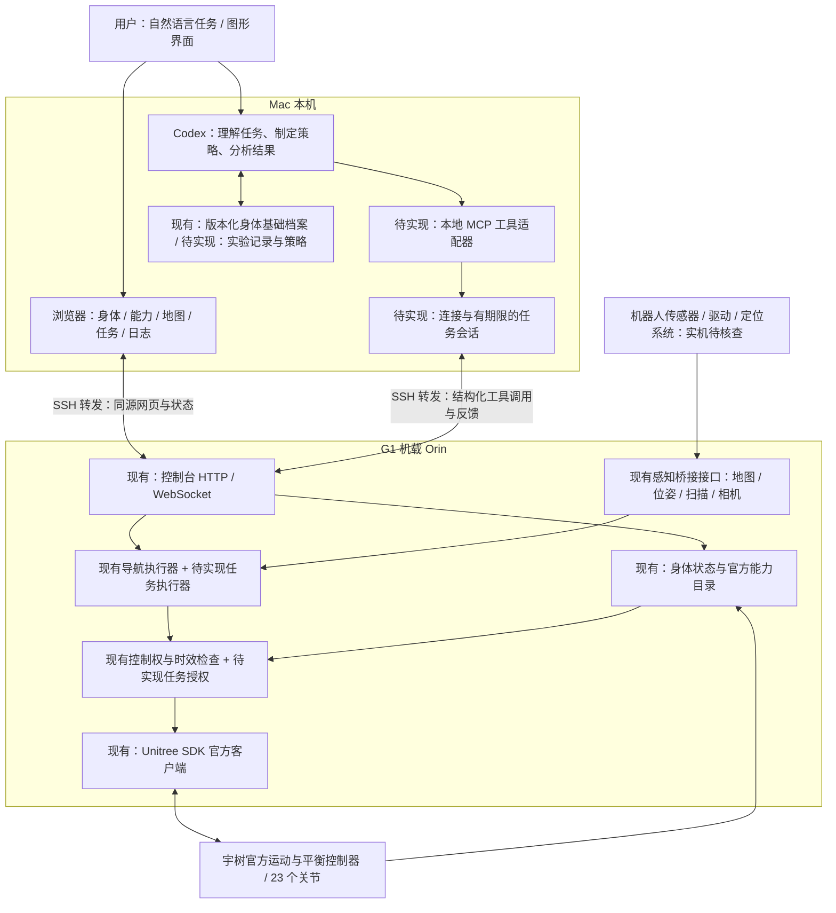
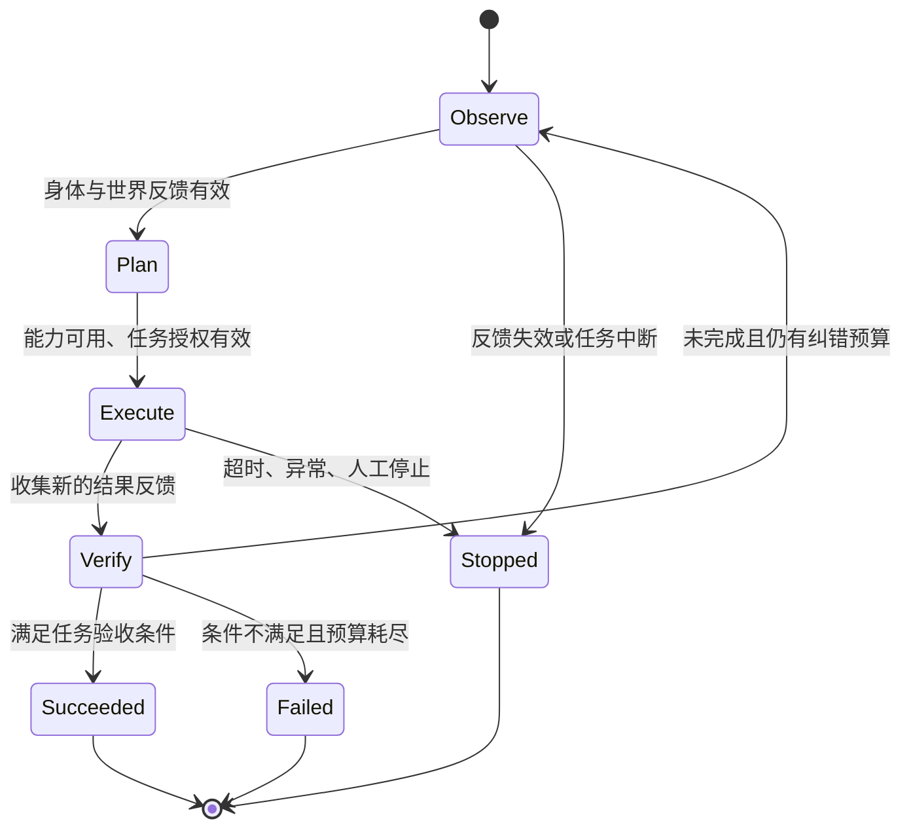

# Mac Codex + G1 Orin 架构设计

设计日期：2026-10-20，北京时间（UTC+8）。设备：G1 EDU、23 自由度、无手部执行器、Jetson Orin。

用户已确认：这里的“训练”是 **Codex 学习身体能力、编写和调试任务策略**，复用已有官方动作，不训练新的运动模型。本文是目标架构与接线方案；“待实现”不代表当前软件已经具备。

**2026-10-21 实现更新：**Mac 已增加单一只读 Codex worker，通过 SSH 获取官方画面、23 关节、IMU、能力目录，再提交有输入批次与过期时间的结构化观察。图形界面显示事实、身体解读、变化和建议，可开始 / 暂停。此处采用已登录的 Codex 服务推理，CLI 实测模型为 `gpt-5.6-sol`，只为观察进程指定，不更改桌面配置。没有接入运动执行；MCP、任务授权、长期策略学习仍待实现。使用与边界见 [自主观察说明](G1_AUTONOMOUS_OBSERVATION.md)，以下架构保留目标设计。

## 1. 总体决策

**Mac 上的 Codex 做任务理解、规划、开发和复盘；Orin 做感知、状态检查、任务执行与反馈纠错；宇树官方控制器继续负责运动和平衡。**



本机 Codex 指客户端、项目和工具运行在 Mac；模型推理沿用当前 Codex 配置，不等于把 Codex 模型权重部署到 M5 或 Orin。任务推理可以慢，身体执行不能等待下一次模型回答。

HomeBody 提供“观察、记忆、逐个调用技能、检查结果”的参考。其仓库在本设计日期仍把 REAL 实机部署代码列为 2026-10-23 计划发布，且硬件依赖与本机配置不同，因此本项目复用这些思路，单独适配现有官方控制接口。[HomeBody 官方仓库](https://github.com/Stanford-TML/homebody)

## 2. 现有基础与缺口

| 模块 | 当前代码 | 本轮设计后的工作 |
| --- | --- | --- |
| 图形界面 | `console/web/`：身体、能力、导航、记录、连接 | 加入机器人身份、Codex 会话与实验进度 |
| 身体档案 | `g1_console/body.py`、官方 XML / STL | 关联实机身份、固件、参数来源与核查日期 |
| 官方能力 | `g1_console/capabilities.py`：47 个 SDK 操作入口 | 建立这台机器逐项核验的能力档案 |
| 官方执行 | `g1_console/adapters.py`：Loco / ArmAction / Audio | 继续使用；不新增低层电机写入 |
| 身体反馈 | HG LowState、CRC、tick、时效检查；Orin 实机 23 关节 / IMU 已验证 | 补电池、相机等可获得的设备信息 |
| 世界状态 | `navigation.py`、`ros_bridge.py` | 接真实驱动 / 定位；后续增加语义观察 |
| 几何导航 | 位姿反馈、A*、扫描检查、有限纠错 | 通过实机验证后作为 Agent 的导航工具 |
| 执行边界 | 单一 owner、2 秒租约、250 ms 速度有效期 | 增加任务授权、距离 / 时间预算与连接世代 |
| 本机 Codex 接入 | `scripts/observe_g1.py` 已实现只读 CLI 视觉观察 | 完整 MCP 和受授权任务工具待实现 |
| 学习与复盘 | 本地事件和最近 40 条导航记录 | 增加结构化实验、候选策略、验证与回退 |

已有 `run_id` 标识控制台进程，观察结果还绑定唯一输入 ticket 和相机来源；运动命令仍未绑定机器人身份或每次连接的世代，现有 API 也没有角色权限和任务授权边界。**MCP、任务授权、可执行语义任务 Agent 与学习流程仍待实现。**

## 3. Mac 如何连接 G1

### 网络与部署

首次接入优先使用网线连接 G1 后颈 RJ45，将 Mac 的有线网卡设为 `192.168.123.222/24`，目标是开发计算单元 PC2 / Orin 的内部地址 `192.168.123.164`。PC1（`192.168.123.161`）运行官方运控，不开放用户登录；机身原有 `G1_****` 热点来自 PC1，不能用它登录 PC2。[官方开发 PC 连接速查手册](https://serviceconsole.unitree.com/index.html#/help/031304)

无线方式需要先在 **PC2 自己的无线网卡** 配置 STA 模式，使 Orin 与 Mac 接入同一家庭 Wi-Fi；无线网段不要与机器人内部 `192.168.123.0/24` 重叠。目前家庭网段 `<LAN_NET>/24` 可保留，之后使用核实过的 PC2 无线地址连接。官方也支持先在 PC2 创建 AP，由 Mac 接入；这是不同于机身 App 热点的入口。[官方连接方式](https://serviceconsole.unitree.com/index.html#/help/031346)、[官方无线配置说明](https://support.unitree.com/home/zh/G1_developer/FAQ)

Mac 只需要访问 Orin SSH；DDS 与 ROS 传感器通信留在机器人侧，不跨 Mac 转发。此方案也避免依赖 Mac 原生运行官方 SDK；官方快速开发文档仍以 Ubuntu 为开发环境。运动前根据实测延迟、丢包与断线表现决定无线是否适用。

| 位置 | 进程与地址 | 作用 |
| --- | --- | --- |
| Mac | 本项目、Codex、本地工具适配器、浏览器 | 开发、规划、任务工具、可视化 |
| Mac | `127.0.0.1:18765` | 通向真实 Orin 的 SSH 转发入口 |
| Mac | `127.0.0.1:8765` | 可选的本地演示，和实机入口分开 |
| Orin | `127.0.0.1:8765` | 图形文件、控制 API、身体与导航服务 |
| Orin | ROS 2 桥接、实际 DDS 网卡 | 读取感知与调用官方运动服务 |

SSH 握手、登录和设备身份确认通过后，在 Mac 建立前台隧道：

```bash
ssh -o ExitOnForwardFailure=yes \
    -o ServerAliveInterval=5 -o ServerAliveCountMax=2 \
    -N -L 127.0.0.1:18765:127.0.0.1:8765 \
    '<Orin用户名>@<Orin地址>'
```

浏览器访问 <http://127.0.0.1:18765/>。界面和 API 都由 Orin 提供，浏览器保持同源。SSH 首次连接核对设备指纹，使用已有登录方式；密码和私钥不写入项目或聊天。SSH 保活用于发现连接故障，不是运动停止的实时保障。

Orin 的安装见 [控制台说明](G1_BODY_CONSOLE.md#在-orin-上运行)。前端可在 Mac 构建后复制 `dist/`，Python / CycloneDDS 原生依赖在 Orin 独立安装。部署按锁定的代码版本进行；不复制 Mac 虚拟环境，不覆盖机器人原有系统服务。控制服务初始状态为未连接，不自动起身或行走。

### 连接顺序与可核验结果

| 顺序 | 操作 | 必须拿到的证据 |
| --- | --- | --- |
| 1 | SSH 只读检查 | 确认目标设备；CPU 架构、系统、JetPack、可用资源、网卡、已有服务 |
| 2 | 确认部署目录与版本 | 原项目位置、锁定依赖、前端构建指纹；保留已有环境 |
| 3 | 启动未连接的控制台、建立隧道 | `/health`、`/ready`、进程 `run_id`；图形界面显示未连接 |
| 4 | 接入真实 DDS，只读采样与查询 | 连续有效 LowState、23 关节映射、IMU、FSM、固件动作列表 |
| 5 | 接入感知并检查时间 | 实际相机 / 扫描话题、TF、地图坐标系、数据年龄、Mac 与 Orin 时钟偏差 |
| 6 | 建立能力档案 | 区分 SDK 定义、固件声明、现场验证；没有手的能力禁用 |
| 7 | 进入有范围的任务调试 | 场地和任务边界明确后，按声光、官方姿态、平地导航逐级验证 |

连接成功的标准是实际服务与数据证据。能 SSH 不代表 DDS 正常；能收到接口应答不代表动作完成。项目旧示例 IP、默认 `eth0`、相机话题均不能作为这台设备的已确认配置。

2026-10-20 已通过 **`unitree@<ORIN_IP>` 成功 SSH 登录**。实机返回 `NVIDIA Orin NX Developer Kit`、`aarch64`、Ubuntu 20.04.6 LTS，网卡为 `wlan0:<ORIN_IP>/24` 与 `eth0:192.168.123.164/24`，核验了 Orin 开发计算单元身份。连接绑定 Mac Wi-Fi `en0`，没有操作 Quantumult X，也没有新增排除项；当前无需网线或显示器即可继续 SSH 工作。用户早先提供的 `.52` 和 `12.1` 仍未核验为 PC2，不能以其握手失败判断 Orin 不可用。23:17 已部署独立只读服务，经 Mac `127.0.0.1:18765` 转发展示实机 23 关节 / IMU；连续 30 帧 tick 递增、CRC 异常 0，并读到 FSM 与 20 个固件动作 ID、4 个命名条目。没有执行动作。部署版本、恢复步骤和证据见 [只读部署记录](G1_ORIN_READONLY_DEPLOYMENT.md)。主机指纹、连接命令及历史检查见 [Mac 连接检查记录](G1_MAC_CONNECTION_CHECK.md)。

## 4. 给 Codex 的工具边界

首版使用 **Mac 本地 STDIO MCP 服务**，内部调用 SSH 隧道后的 HTTP API。CLI 与 MCP 共用客户端和校验逻辑，CLI 先用于接线和诊断。Codex 官方支持本地 STDIO MCP 以及项目级配置；接入方式按官方文档核查。[OpenAI MCP 文档](https://learn.chatgpt.com/docs/extend/mcp?surface=cli)

以下是拟议工具契约，不是当前可用工具：

| 工具 | 输入与返回 | 约束 |
| --- | --- | --- |
| `read_body` | 身体档案、当前关节与 IMU、状态来源和年龄 | 只读；未知参数保留未知 |
| `list_capabilities` | 官方参数定义、固件声明、实测结果、前置条件 | 只返回与当前硬件相符的能力 |
| `observe` | 位姿、局部地图、障碍、事件；可选最新图像 | 保留采样时间、坐标系和来源；图像按需读取 |
| `invoke_capability` | 能力 ID、严格参数、任务授权 ID | 受限的官方操作；不接收任意代码 / RPC / 电机目标 |
| `navigate_to` | 当前地图坐标目标、坐标系、地图版本、任务预算 | Orin 本地闭环；不依赖模型持续发送速度 |
| `task_status` | task ID；阶段、进展、反馈证据、错误 | 接口接受与实测完成分开返回 |
| `stop` | 停止原因；命令应答与可获得的反馈 | 可打断当前任务；不以取得运动租约为前提 |
| `record_experiment` | 假设、前后观察引用、结果、候选策略版本 | 记录经验；不能借此修改控制限制 |

机器人工具只提供结构化能力；SSH 部署与文件编辑属于 Codex 的开发流程，不作为实时动作工具。机器人文字、图像和环境内的提示都是观测数据，不能改变任务授权、工具权限或控制参数。

现有本地会话可以通过 `/api/session` 建立，再访问认证 API；工具适配器在本机保管会话，不把 token 放进模型上下文。当前所有已认证 API 共享同一权限，后续必须在 Orin 增加服务端角色和任务权限检查，不能仅靠 MCP 工具描述限制操作。首轮接线只开放只读工具。

默认给 Codex 发送状态摘要和必要证据；原始连续视频留在机器人侧。按需图像或工具结果进入 Codex 上下文时，会遵循当前模型服务的数据路径，不能宣称全部推理与数据都留在 Mac。

## 5. 任务执行、反馈与中断

### 两种循环分别运行

| 循环 | 所在位置 | 节奏与职责 |
| --- | --- | --- |
| 任务推理 | Mac Codex | 按步骤触发，可耗时数秒至更久；提出目标、分析偏差、选择下一能力 |
| 有期限的会话维护 | Mac 本地服务（待实现） | 初始设计每 0.5 秒心跳；只为有效的有限任务维持租约 |
| 感知与导航 | Orin | 现有导航目标 10 Hz、状态检查目标 50 ms；检查地图、身体、任务进展 |
| 运动与平衡 | 官方机器人控制器 | 保留官方实现；不由 Mac 或语言模型替代 |

现有 Python 控制循环是软实时，同一循环会等待 SDK 调用，50 ms 不是最坏延迟保证。官方速度请求显式使用 250 ms duration；实际固件的超时行为仍需现场验证。后续把任务管理与执行健康检查隔离，保留官方短时速度有效期，不把新增守护进程当作已验证的硬实时系统。

MCP 单次调用返回后，不能假设模型会及时调用下一次心跳。Mac 会话服务应独立维护有限任务；它仅在任务授权、反馈和总预算都有效时续租。Orin 端同时检查授权截止时间，避免“Mac 进程活着就无限续租”。任务到期、隧道断开或反馈无效时停止继续移动；重连后重新观察，不自动恢复任务。

### 任务授权契约（待实现）

每项真实任务绑定：`robot_id`、`run_id`、`connection_epoch`、`task_id`、控制 owner、能力白名单、参数上限、地图 / 场地范围、最大路程、最大耗时、允许纠错次数与策略版本。设备身份通过现场确认建立，不用“23 自由度”代替唯一身份。

`run_id` 变化或断开重连导致 `connection_epoch` 变化，都撤销旧任务。Orin 在受理时校验客户端时间偏差，并用自己的单调时钟管理期限；任务中的每一步再次检查权限、身份、期限和反馈，不能只在开始时校验一次。

控制台 Stop 优先打断 Agent 的当前任务并使任务授权失效，恢复须重新发起任务。当前已有停止入口和 owner 租约；上述任务授权撤销、人工接管流程、连接世代校验尚需实现。软件 Stop 是停止行走请求，不替代实体急停，也不保证中止每一种已启动的官方手势。

同一运动模式只允许一个应用层运动写入者；旧调试脚本、遥控通道和新增 Agent 的冲突必须在接线时排查。官方平衡控制器继续运行。共享任意 shell 或运行另一个 SDK 脚本可以绕过本项目仲裁，因此任务运行期间不热更新控制代码、不同时启动其他应用运动脚本。

### 成功与纠错



导航以实际定位验证到达；官方状态切换以新的 FSM 回读验证；手势缺少完成信号时返回“已接受 / 未确认”，不写入“成功学会”。几何闭环可以根据位置偏差重规划；“找门并走过去”等语义任务还需要目标识别、深度 / 几何定位、可达性与结果验证，不能把图像中的一个点直接换成行走坐标。

## 6. Codex 学习什么

### 身体与能力档案

每个条目记录来源和可信状态：官方资料、固件回读、现场测量或尚未知。23 关节使用官方稀疏电机编号；温度、电压、角度、估计力矩等动态反馈与 XML 参考范围分开保存。电机 Kp / Kd、持续力矩、出厂标定、精确摩擦等未提供的信息不能通过提示词补齐，也不以试到极限的方式“学习”。

能力档案记录：输入参数、前置状态、互斥能力、可能影响的身体部位、可获得的完成证据、停止方式、适用场地和最近验证版本。SDK 有入口仅表示可尝试查询，固件声明也不等于已在当前场地验证成功。

“物理思维”落在这些可检验约束上：身体尺寸与净空、关节范围、支撑与姿态、惯性引起的延迟、路径可达性、地面条件以及观测不确定性。语言模型负责推理这些约束；底层执行仍以传感器反馈和确定性检查为准。

### 策略学习流程

1. Codex 根据能力档案和现场观察提出一个可检验假设，例如“路线拐角过近，应增大障碍余量”。
2. 在 Mac 修改版本化任务策略；先用记录回放 / 演示验证结构和逻辑。演示不能证明实机平衡。
3. 以有限真实任务执行，记录前置状态、代码 / 策略版本、官方错误码、实测位姿与中断原因。
4. 比较预期和实际结果：任务成功率、误差、耗时、纠错次数、被约束拦截次数，以及温度变化等反馈。
5. 把有证据的变化提升为可回退的策略版本；失败保留原因，后续执行时重新核查环境与能力条件。

学习产物是能力知识、场景记忆、任务配方与纠错规则；不更新官方运动模型权重，不调整底层电机增益或放宽执行限制。场景记忆绑定地图版本和设备身份，历史成功不能替代当前观察。测试场景扩展后重新验证，不能凭一次成功宣布适应所有环境。

“细胞 Agent”可作为模块化思路：身体监测、环境观察、导航、能力调度、结果验证各自维护状态并共享同一世界模型。关节之间强耦合，23 个电机不分别交给 23 个语言模型自由决策；运动写入始终经过同一仲裁与官方控制。

## 7. 拟新增的代码布局

以下目录为后续实现规划，目前不存在相应功能：

```text
g1_agent/                      # Mac 侧
  cli.py                       # 只读接线、诊断，与 MCP 共用客户端
  client.py                    # 会话、身份、超时、结构化 API
  mcp_server.py                # Codex STDIO 工具入口
  session.py                   # 有期限的任务会话与心跳
  knowledge.py                 # 实验记录、能力核验、策略版本
g1_console/                    # 现有 Orin 服务继续扩展
  identity.py                  # 拟新增：设备身份与连接世代
  tasks.py                     # 拟新增：任务契约、授权与进度
config/g1.connection.example.toml  # 拟新增：无密钥连接模板
policies/                      # 拟新增：可审阅的任务策略
.g1-console/                   # 现有忽略目录；本地运行状态
```

连接配置只保存 SSH 目标、远端项目目录、转发端口、预期设备身份，不保存密码或私钥。MCP 配置在服务完成后再接入，不预先注册不存在的工具。Mac 修改通过检查后，在机器人无进行中任务时部署到明确版本；部署失败回到上一可用版本，不让 Codex 在移动中修改执行器。

## 8. 实施顺序与验收

| 阶段 | 交付 | 完成证据 |
| --- | --- | --- |
| P0：本轮 | 架构、职责、连接与学习契约 | 本文与现有代码核对；用户确认不训练运动模型 |
| P1：接线（已验收） | Mac → Orin SSH、真实只读界面与身体反馈 | 2026-10-20 实机 23 关节 / IMU、固件清单、30 帧递增反馈与 CRC；见部署记录 |
| P2：Codex 能力工具 | CLI + MCP、任务授权、会话服务、人工停止与恢复流程 | 只读工具可用；有限声光 / 官方动作反馈；身份变化及断线测试 |
| P3：自主观察导航 | 实机驱动 / 定位接入、受控场地目标执行 | 真实反馈验证到达；障碍、旧帧、超时、中断后不恢复的证据 |
| P4：策略学习 | 实验记录、候选策略、回放比较、版本提升 / 回退 | 相同验收任务下改进有证据；可追溯到数据与策略版本 |

P2 的运动工具启用前必须完成任务权限在 Orin 的强制校验；P3 的语义目标功能按感知条件逐项增加。P1 的只读接线已完成；P2–P4 的工具、真实动作、导航及策略学习尚未完成实机验收。

设备没有手，抓取相关能力不在当前目标内。已有官方服务允许的动作组合也受固件、观测、接触条件和环境限制；相机、二维地图和 IMU 不能据此保证永不摔倒。首个实机闭环限定为已检查的平整场地、有限路线、持续反馈、可中断的官方能力调用。

## 9. 核查记录

- 架构阶段核对 HTTP 接口、控制租约、导航执行器、状态 `run_id` 和 SDK 调用边界；部署阶段增加服务与适配器的强制只读拦截，以及实机固件列表解析。
- Mac 已安装 `codex-cli 0.135.0`，支持 MCP 管理命令；按官方文档确认本地 STDIO 接入方式。尚未注册 G1 MCP 服务。
- 宇树接口继续使用 `unitree-deps.lock.json` 锁定的官方 SDK；没有因架构设计切换依赖版本。
- 已从 Mac 邻居缓存发现 `.28`，通过官方默认账号核验 Orin；现已部署只读控制台，Mac 界面展示真实身体反馈和固件清单。未发送任何机器人动作。
- 重新核对官方 PC1 / PC2 拓扑及有线、AP、STA 三种接入方式；实机已具备 PC2 无线连接，可继续采用 PC2 STA + Mac SSH，DDS 留在机器人内部。查找和登录 `.28` 期间没有操作 Quantumult X。
